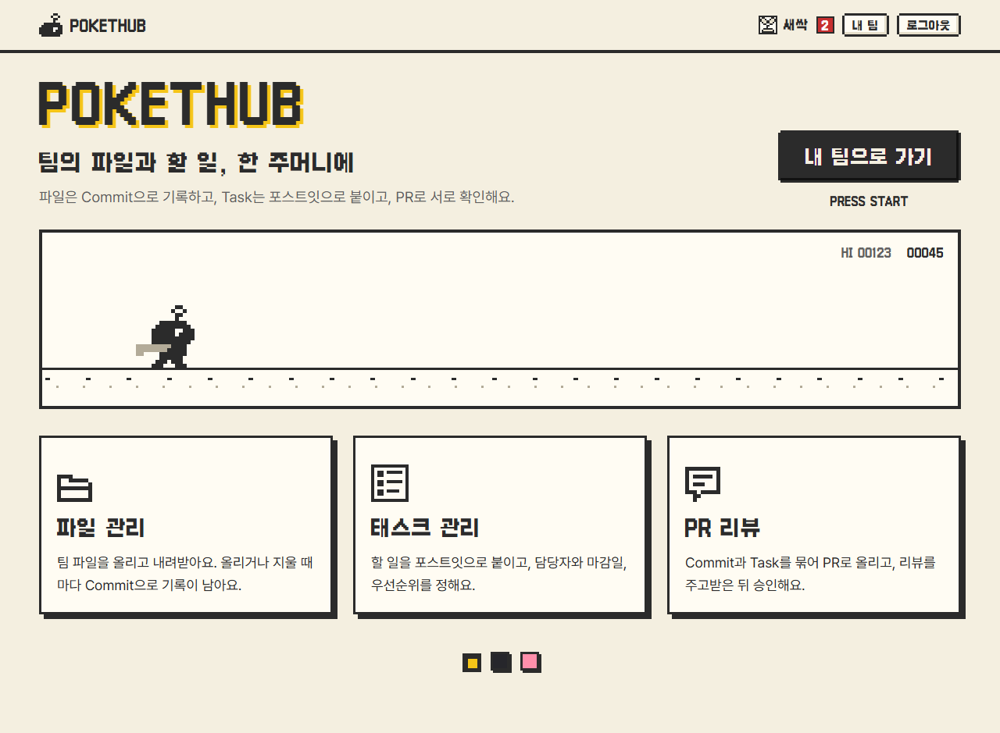
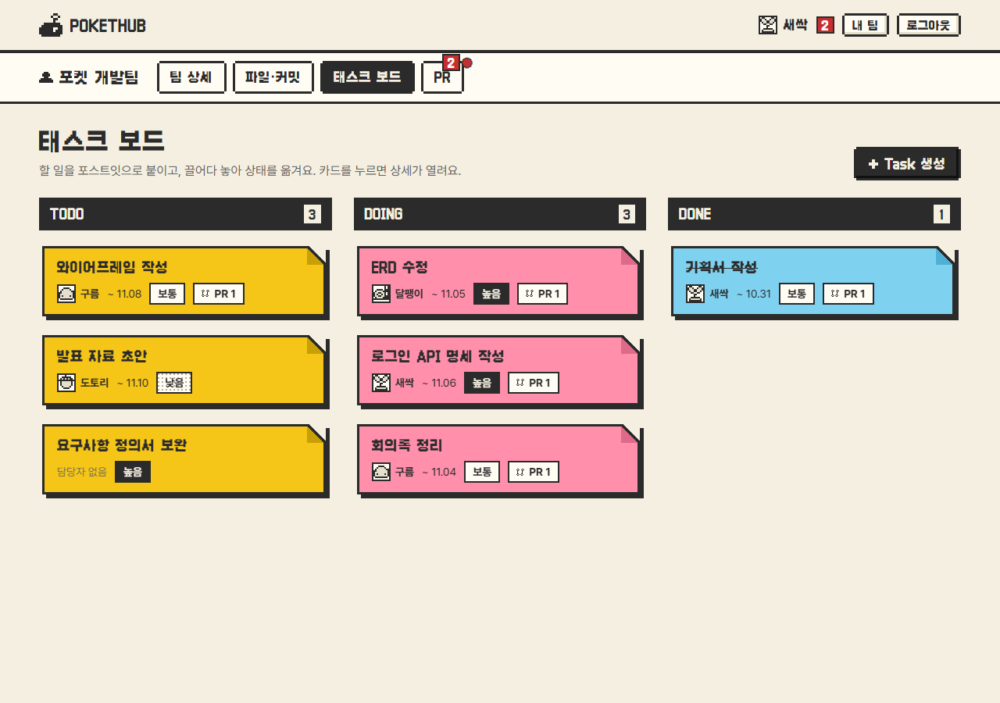
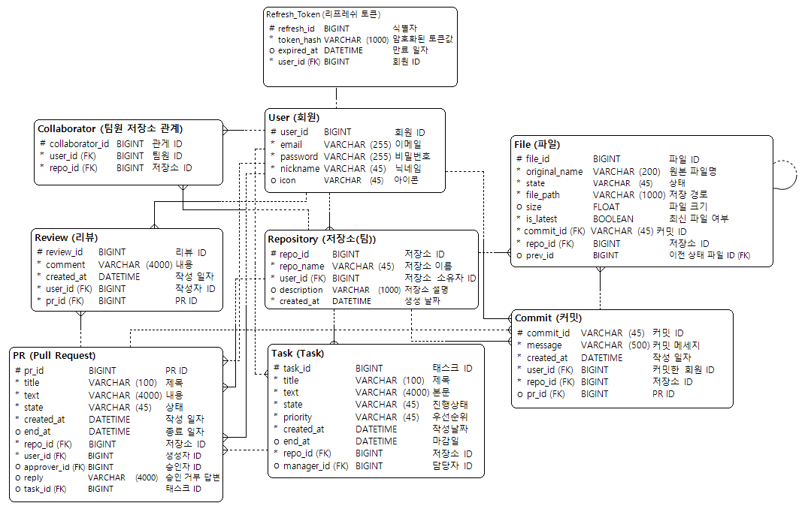

# PocketHub (포켓헙)

> 파일 버전 관리와 일정 관리를 한 곳에서 하는 **팀 협업 플랫폼**
>
> Git을 몰라도 쓸 수 있도록 커밋 → PR → 리뷰 → 승인 흐름을 웹에서 쉽게 따라 할 수 있게 만들었습니다.

<p align="center">
  
  
</p>

<br>

## 목차
1. [프로젝트 소개](#프로젝트-소개)
2. [주요 기능](#주요-기능)
3. [기술 스택](#기술-스택)
4. [ERD](#erd)
5. [API 명세](#api-명세)
6. [폴더 구조](#폴더-구조)
7. [시작하기](#시작하기)
8. [테스트](#테스트)
9. [협업 규칙](#협업-규칙)
10. [팀원](#팀원)

<br>

## 프로젝트 소개

| 항목 | 내용 |
| --- | --- |
| 프로젝트명 | PocketHub (포켓헙) |
| 한 줄 소개 | 파일 및 일정 관리 기반 협업 플랫폼 |
| 기획 기간 | 2026.11.02 ~ 2026.11.10 |
| 개발 기간 | 2026.11.11 ~ 2026.11.19 |
| 인원 | 5명 |

팀 단위로 저장소(팀) 를 만들고, 팀원끼리 파일을 올리고(커밋), 할 일(Task)을 관리하며,
변경 사항을 **Pull Request**로 묶어 리뷰·승인하는 흐름을 제공합니다.

<br>

## 주요 기능

### 회원 · 인증
- 회원가입 / 로그인 / 로그아웃
- **JWT Access Token + Refresh Token** 기반 인증, 토큰 재발급

### 팀(저장소)
- 팀 생성·수정·삭제 (팀장만 수정·삭제 가능)
- 팀원 초대·삭제, 팀원 목록 조회
- 팀원이 아니면 팀 API에 접근할 수 없음

### 파일 · 커밋
- 파일 업로드 = 커밋 생성
- 파일 삭제도 커밋으로 기록 (추가 / 수정 / 삭제 상태 관리)
- 파일 최신 버전 관리 
- 커밋 이력 조회, 커밋 단위 / 파일 단위 다운로드

### Task
- Task 생성·수정·삭제, 담당자·우선순위(LOW / MEDIUM / HIGH)·마감일 지정
- 칸반 보드 (TODO ↔ DOING ↔ DONE 드래그&드랍으로 상태 변경)
- Task에 연결된 PR 조회

### Pull Request · 리뷰
- 내 커밋을 골라 PR 생성
- 리뷰 작성·수정·삭제
- **승인** → PR 완료
- **거부** → 거부 사유 저장 + PR에 포함된 파일의 최신 버전 되돌리기
- 작성자 본인은 자신의 PR을 승인·거부할 수 없음

### 마이페이지 · 기타
- 내가 맡은 Task, 내가 리뷰할 PR, 내 팀, 최근 커밋 모아 보기
- 프로필 아이콘 변경
- PR 알림 배지 
- 테마 3종 (기본 / 다크 / 핑크)

<br>

## 기술 스택

### Backend


### Frontend


### Database


### Collaboration


<br>

## ERD
<p align="center">
  
</p>

<br>

## API 명세

Base URL: `/api/v1` · 🔓 = 로그인 없이 호출 가능

<details>
<summary><b>회원 · 인증</b></summary>

| Method | URL | 설명 |
| --- | --- | --- |
| POST | `/members` 🔓 | 회원가입 |
| GET | `/members/me` | 내 정보 조회 |
| PATCH | `/members/me` | 프로필 아이콘 변경 |
| POST | `/auth/login` 🔓 | 로그인 |
| POST | `/auth/reissue` 🔓 | 토큰 재발급 (Refresh Token 쿠키) |
| POST | `/auth/logout` 🔓 | 로그아웃 |
</details>

<details>
<summary><b>팀 · 팀원</b></summary>

| Method | URL | 설명 |
| --- | --- | --- |
| POST | `/teams` | 팀 생성 |
| GET | `/teams` | 내 팀 목록 |
| GET | `/teams/{teamId}` | 팀 상세 |
| PATCH | `/teams/{teamId}` | 팀 수정 |
| DELETE | `/teams/{teamId}` | 팀 삭제 |
| GET | `/teams/{teamId}/members` | 팀원 목록 |
| POST | `/teams/{teamId}/members` | 팀원 추가 |
| DELETE | `/teams/{teamId}/members/{userId}` | 팀원 삭제 |
</details>

<details>
<summary><b>파일 · 커밋</b></summary>

| Method | URL | 설명 |
| --- | --- | --- |
| POST | `/teams/{teamId}/commits` | 파일 업로드 커밋 (`multipart`: `files`, `commitMessage`) |
| DELETE | `/teams/{teamId}/commits/{fileId}?commitMessage=` | 파일 삭제 커밋 |
| GET | `/teams/{teamId}/commits` | 커밋 목록 |
| GET | `/teams/{teamId}/commits/{commitId}` | 커밋 상세 |
| GET | `/teams/{teamId}/commits/{commitId}/download` | 커밋 파일 다운로드 |
| GET | `/teams/{teamId}/files` | 파일 목록 |
| GET | `/teams/{teamId}/files/{fileId}` | 파일 상세 |
| GET | `/teams/{teamId}/files/{fileId}/download` | 파일 다운로드 |
</details>

<details>
<summary><b>Task</b></summary>

| Method | URL | 설명 |
| --- | --- | --- |
| POST | `/teams/{teamId}/tasks` | Task 생성 |
| GET | `/teams/{teamId}/tasks` | Task 목록 |
| GET | `/teams/{teamId}/tasks/{taskId}` | Task 상세 |
| PATCH | `/teams/{teamId}/tasks/{taskId}` | Task 수정 |
| PATCH | `/teams/{teamId}/tasks/{taskId}/status` | 상태 변경 (TODO / DOING / DONE) |
| DELETE | `/teams/{teamId}/tasks/{taskId}` | Task 삭제 |
| GET | `/teams/{teamId}/tasks/{taskId}/pulls` | Task에 연결된 PR 목록 |
</details>

<details>
<summary><b>Pull Request · 리뷰</b></summary>

| Method | URL | 설명 |
| --- | --- | --- |
| POST | `/teams/{teamId}/pulls` | PR 생성 |
| GET | `/teams/{teamId}/pulls?status=` | PR 목록 (상태별) |
| GET | `/teams/{teamId}/pulls/{prId}` | PR 상세 |
| PATCH | `/teams/{teamId}/pulls/{prId}` | PR 수정 |
| PATCH | `/teams/{teamId}/pulls/{prId}/task` | 연결 Task 변경 |
| DELETE | `/teams/{teamId}/pulls/{prId}` | PR 삭제 |
| POST | `/teams/{teamId}/pulls/{prId}/approve` | PR 승인 (연결 Task → DONE) |
| POST | `/teams/{teamId}/pulls/{prId}/reject` | PR 거부 (사유 저장, 파일 최신 버전 되돌림) |
| POST | `/teams/{teamId}/pulls/{prId}/reviews` | 리뷰 작성 |
| GET | `/teams/{teamId}/pulls/{prId}/reviews` | 리뷰 목록 |
| PATCH | `/teams/{teamId}/pulls/{prId}/reviews/{reviewId}` | 리뷰 수정 |
| DELETE | `/teams/{teamId}/pulls/{prId}/reviews/{reviewId}` | 리뷰 삭제 |
</details>

**공통 응답 예시**
```json
{
  "success": true,
  "status": 200,
  "message": "로그인에 성공했습니다",
  "data": { "accessToken": "...", "tokenType": "Bearer", "expiresIn": 3600 },
  "pageInfo": null
}
```

<br>

## 폴더 구조

```
PocketHub
├── backend/                     Spring Boot API 서버
│   ├── db/schema.sql            MySQL 스키마 (직접 실행)
│   └── src/main/java/com/pockethub
│       ├── common/              auth(JWT·인터셉터) · config · exception · response · validation
│       ├── auth/  user/  team/  file/  commit/  task/  pr/  review/
│       │    └── controller · service · repository · domain · dto
│       └── PockethubApplication.java
├── frontend/                    Next.js (App Router)
│   ├── app/                     주소별 화면
│   ├── components/              기능별 화면 조각
│   ├── services/                API 호출 (화면은 여기 함수만 사용)
│   ├── mocks/                   브라우저 안 목업 서버
│   └── e2e/                     Playwright 테스트·기준 스크린샷
├── docs/convention.md           팀 컨벤션
└── .github/                     Issue · PR 템플릿
```

자세한 내용은 [backend/README.md](backend/README.md), [frontend/README.md](frontend/README.md)를 참고하세요.

<br>

## 시작하기

### 요구 사항
- JDK 21
- MySQL 8
- Node.js 20 이상

### 1. 저장소 클론
```bash
git clone https://github.com/PocketHub-SeSAC/PocketHub.git
cd PocketHub
```

### 2. 데이터베이스 준비
```bash
mysql -u <사용자> -p < backend/db/schema.sql
```
> `ddl-auto: none` 설정이라 앱이 테이블을 자동으로 만들지 않습니다. 스키마는 직접 실행해 주세요.

### 3. 백엔드 실행
`backend/.env.example`을 참고해 환경변수를 설정합니다.

| 변수 | 설명 |
| --- | --- |
| `DB_USERNAME` | MySQL 사용자 |
| `DB_PASSWORD` | MySQL 비밀번호 |
| `JWT_SECRET` | JWT 서명 키 (충분히 긴 임의 문자열) |

```bash
cd backend
./gradlew bootRun
```
→ http://localhost:8080

### 4. 프론트엔드 실행
`frontend/.env.example`을 복사해 `frontend/.env.local`을 만듭니다.

| 변수 | 설명 |
| --- | --- |
| `NEXT_PUBLIC_USE_MOCK` | `true`: 목업 데이터로 동작 / `false`: 실제 백엔드 호출 |
| `NEXT_PUBLIC_API_URL` | 백엔드 주소 (예: `http://localhost:8080`) |

```bash
cd frontend
npm install
npm run dev
```
→ http://localhost:3000

> 목업 모드에서는 `saessak@example.com` / `password123` 계정으로 바로 로그인해 볼 수 있습니다.

<br>

## 테스트

```bash
# 백엔드 단위 테스트 (JUnit 5)
cd backend && ./gradlew test

# 프론트엔드 E2E 테스트 (Playwright, 처음 한 번 npx playwright install chromium)
cd frontend && npm test
```

- 백엔드: JWT 발급·검증, 팀 / PR / 리뷰 서비스, 입력 검증 규칙 테스트
- 프론트엔드: 화면 34장 스크린샷 비교, 로그인·팀·파일·Task·PR 사용자 흐름 테스트

<br>

## 협업 규칙

자세한 규칙: [docs/convention.md](docs/convention.md)

1. `dev`에서 `feature/` · `fix/` · `hotfix/` 브랜치를 만들어 작업하고, `main` · `dev`에는 직접 push하지 않습니다.
2. 커밋 메시지는 `타입: 한글 내용` 형식입니다 (feat, fix, docs, style, refactor, test, chore, perf).
3. PR 제목은 `[타입] 작업 내용`, 대상은 `dev`이며 1명 이상 승인 후 병합합니다.
4. `.env` 등 실제 환경변수와 개인 설정 파일은 올리지 않습니다.

<br>

## 팀원

| 이름 | 역할 | 담당 기능 | GitHub |
| --- | --- | --- | --- |
| 김규리 | 팀장 / BE | 회원 · 인증 | [@fhdl1221](https://github.com/fhdl1221) |
| 김성은 | BE | 팀 · 팀원 | [@ooing404](https://github.com/ooing404) |
| 류가연 | BE | 파일 · 커밋 | [@yeon-ryu](https://github.com/yeon-ryu) |
| 조영동 | BE · FE | Task · 프론트엔드| [@micle1742-glitch](https://github.com/micle1742-glitch) |
| 문건후 | BE | PR · 리뷰 | [@who307](https://github.com/who307) |
